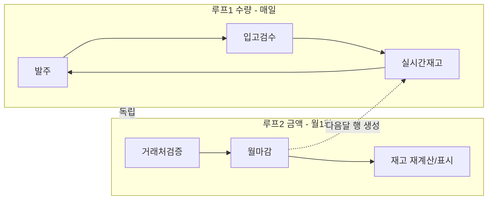

# 업무 프로세스 · 발주/배송 확장 · 요구사항정의서

| 항목 | 내용 |
|------|------|
| 문서명 | 업무 프로세스(수량 루프 / 금액 루프) + 발주·배송·거래처2 확장 |
| 대상 앱 | GAS 웹앱 (`webapp/`) |
| 관련 문서 | `docs/월마감_체크리스트.md`, `docs/요구사항정의서_기준월선택UI.md` |
| 작성일 | 2026-11-10 |
| 상태 | **D1~D5 확정 · 구현 진행 (j95)** |

---

## 0. 한 줄 요약

- **루프1(수량)**: 발주 → 입고검수 → 실시간재고(열린 달) → 발주. **금액검증·월마감 없이도 계속 가능.**
- **루프2(금액)**: 거래처검증 → 월마감 → 실시간재고 재계산·표시. **월별 검증 끝난 뒤**, **익월 1일부터** 마감.
- **마스터/발주 확장**: 배송방법·입고예정일·거래처1/거래처2(+직접입력).

---

## 1. 현재 상태 vs 요청

| 요청 | 현재 | 갭 |
|------|------|-----|
| 루프1 연속 운영 | 발주·입고검수·재고계산·POS연동 존재. 열린달만 발주/재고계산 | 대체로 가능. “마감달 이후~현재” **여러 달을 한 화면에 이어 보여주기**는 미구현(지금은 기준월 1개 선택) |
| 루프2 독립 | 월마감은 검증 완료를 **강제하지 않음**(체크리스트만) | **가드(차단) 없음** |
| 익월 1일부터 마감 | `jobMonthlyClose`에 **날짜 제한 없음** | 달력 가드 추가 필요 |
| 발주내역 입고예정일·배송방법 | 헤더 `발주일자,원재료코드,품목명,주거래처,발주수량(Box),상태` | **컬럼 추가 + `주거래처`→`거래처` rename** |
| 거래처관리 배송방법 | 시트 마스터(앱 UI 거의 없음) | **시트 컬럼 + 발주 시 초기값 읽기** |
| 주거래처→거래처1, 거래처2, 콤보 | 코드가 헤더 `"주거래처"`만 읽음 | **헤더 호환 + UI 콤보 + 저장 vendor** |
| 마감 독촉(매월 5일) | 없음 | **미마감이면 독촉 문구 표시** |

---

## 2. 프로세스 요건 (확정 후보)

### 2.1 루프1 — 수량 연속성 (필수 일상)

```
발주 → 입고검수 → 실시간재고 계산/조회 → (부족 시) 발주 …
```

| ID | 요건 | 비고 |
|----|------|------|
| P1-1 | 입고검수(반영완료) 후, **해당 열린 달**에 재고행이 있으면 실시간 재고 계산 가능 | 현재와 동일(A안) |
| P1-2 | 월마감 전까지 열린 달은 POS(`pos판매내역`)·입고·조정을 반영해 현재고 표시 | 현재 `jobCalculateInventory` |
| P1-3 | **전월 월마감이 생기면** 다음달 행이 생기고, 그달부터 다시 재고계산·발주 | 현재 월마감 동작 |
| P1-4 | 루프2(검증·마감)를 **안 해도** 루프1은 계속 진행 | **유지·명시**. 마감 가드를 루프1에 걸지 않음 |
| P1-5 | 화면 범위: **마감 완료된 달의 다음 달 ~ 오늘 달력월**을 “열린 구간”으로 취급 | 기준월 셀렉트 목록과 정렬. 1차: 기존 월 선택 유지 / 2차(선택): 열린 구간 안내 배너 |

### 2.2 루프2 — 금액 마감 (월 1회)

```
거래처 금액 검증(OK) → 월마감 → 실시간재고(마감달 다음~현재) 재계산·표시
```

| ID | 요건 | 비고 |
|----|------|------|
| P2-1 | 입고검수 = **수량**. 거래처검증 = **전표금액·월말 누적결제 검증** | 역할 분리 유지 |
| P2-2 | 월마감 직전 **거래처검증 미완료·이상 건이 있으면 경고만** (차단하지 않음) | **확정: 경고만** |
| P2-3 | **당월(M) 마감은 M+1월 1일 00:00(Asia/Seoul)부터** 가능 | 예: 10월 마감 → 11/1부터 |
| P2-4 | 월마감 후 UI는 최신(다음) 달 재고를 보여 주고, 필요 시 **실시간 재고 계산** 재실행 안내 | 체크리스트와 맞춤 |
| P2-5 | 루프2 미완료여도 루프1(검수·발주·열린달 재고) 가능 | P1-4와 동일 |
| P2-6 | **달력일 기준 매월 5일~(마감 완료 전)** 전월(또는 마감 대상월)이 아직 마감되지 않으면 **마감 독촉 문구** 표시 | 차단 아님. 배너/토스트. 예: 「11/5인데 10월 월마감이 아직입니다」 |

### 2.3 두 루프 관계



---

## 3. 시트·화면 확장 요건

### 3.1 `발주내역` 컬럼 추가

| 컬럼 | 타입/예시 | 규칙 |
|------|-----------|------|
| 거래처 | 텍스트 | **구 헤더 `주거래처` → `거래처`로 변경.** 코드는 `거래처` 우선, 없으면 `주거래처` 폴백 |
| 입고예정일 | `yyyy-MM-dd` | **기본값(달력일)**: 발주일 기준 **택배=+2일**, **마트구매·거래처배송=+1일**. 거래처휴무·임시공휴일 등에 대비해 **날짜 선택(수정) 가능** |
| 배송방법 | `마트구매` / `거래처배송` / `택배` | 발주 시 초기값 = 거래처관리.배송방법 → 없으면 거래처배송 기본. 변경 시 예정일 기본값 재계산(사용자가 수동 바꾼 날짜는 유지할지 — 권장: 배송방법 바꾸면 기본값으로 다시 채우되, 확인 후) |

기존 헤더와의 호환: 헤더명으로 열을 찾고, 없으면 append. 구형 6열(`주거래처`) 시트도 읽기 가능해야 함.

### 3.2 `거래처관리` 컬럼 추가

| 컬럼 | 규칙 |
|------|------|
| 배송방법 | 허용값 동일 3종. 발주 화면에서 해당 거래처 선택 시 **초기 세팅** |

앱에 거래처 CRUD가 없으면 **시트에 직접 입력**이 작업 전제.

### 3.3 `원재료관리` 컬럼 변경

| 변경 | 규칙 |
|------|------|
| `주거래처` → `거래처1` | 헤더 rename. 코드는 `거래처1` 우선, 없으면 `주거래처` 호환 |
| `거래처2` 신설 | 선택적 대체 거래처 |
| 발주 UI | 거래처 콤보: **거래처1 / 거래처2 / 직접입력** (직접입력 시 텍스트박스) |
| 카톡·발주저장 | **선택한 거래처명**을 `발주내역`의 **`거래처`** 열에 저장 (**확정**) |

---

## 4. 가능 여부 · 장단점 · 추천

### 4.1 가능 여부

| 항목 | 가능? | 난이도 |
|------|:-----:|--------|
| 루프1 문서화·안내 강화 | ✅ | 낮음 |
| 월마감 = 익월1일 가드 | ✅ | 낮음 |
| 월마감 전 검증 경고(차단 없음) | ✅ | 낮음 |
| 매월 5일~ 미마감 독촉 문구 | ✅ | 낮음 |
| 발주내역 거래처 rename + 예정일·배송 | ✅ | 중 |
| 거래처관리 배송방법 | ✅ | 낮음(시트)+중(발주 연동) |
| 거래처1/2 + 콤보 | ✅ | 중 |
| “마감 이후~현재” 다월 한 화면 합산 재고 | △ | 높음 — **1차 비추천**. 월 선택으로 충분 |

### 4.2 장단점

| | 장점 | 단점 |
|--|------|------|
| 루프 분리 | 검수·발주가 마감에 막히지 않음 | 금액 미검증으로 달이 밀릴 수 있음 → **5일 독촉**으로 보완 |
| 익월1일 마감 | 당월 POS·입고 유입과 충돌 감소 | 말일 밤 마감 습관과 다름 → 운영 안내 필요 |
| 배송/예정일 | 기본 +1/+2 + **날짜 수정**으로 휴무·공휴 대응 | 수동 수정 누락 시 예정일 오차 |
| 거래처2·직접입력 | 일시 대체 발주 유연 | 마스터 품질·카톡 묶음 기준이 선택값에 의존 |

### 4.3 추천 (구현 순서)

1. **문서·운영 먼저**: 루프1/2 분리, 체크리스트에 “검증 후 마감·익월1일” 반영.  
2. **가드·안내 코드**: 월마감 익월1일 가드 + 검증 **경고만** + **매월 5일~ 미마감 독촉 문구**.  
3. **시트 컬럼**: 거래처관리.배송방법 → 원재료관리 거래처1/2 → 발주내역(`거래처` rename + 예정일·배송방법).  
4. **발주 UI**: 콤보 + 예정일 기본(달력 +1/+2) + **date picker로 수정** + 저장.  
5. **보류**: 다월 합산 재고 화면, 거래처관리 전용 웹 CRUD.

---

## 5. 작업 플로우 (개발)

```
[0] D1~D3·P2-6 확정됨 (본 문서)
[1] 시트 백업(사본)
[2] 시트 헤더/샘플 데이터 수동 추가 (§6) — 발주내역 `주거래처`→`거래처`
[3] GAS: 헤더 호환 읽기 + 월마감 익월1일 가드 + 검증 경고 + 5일 독촉 API/플래그
[4] 프론트: 발주 콤보·예정일(기본+date)·배송방법·독촉 배너
[5] build → clasp push → deploy
[6] 스모크: 발주1건 → 예정일 수정 → 검수 → 재고계산 / 검증 경고 / 독촉 문구
[7] 체크리스트·본 문서 잔여 미결(D4~D5) 처리
```

---

## 6. 작업 전·후 — 사용자(sang)가 할 일

### 6.1 작업 전 (직접 해주세요)

1. 구글시트 **파일 → 사본 만들기**  
   - 이름 예: `재고_프로세스확장전_2026-11-10`  
   - 성공: 드라이브에 사본이 보임.
2. **거래처관리** 시트 1행(헤더)에 `배송방법` 열 추가.  
   - 각 거래처에 `마트구매` / `거래처배송` / `택배` 중 하나 입력.  
   - 비우면 발주 시 기본 `거래처배송`으로 둘 예정.
3. **원재료관리**  
   - `주거래처` 헤더를 `거래처1`로 바꾸거나, 새 열 `거래처1`을 만들고 값 복사 후 구열 비우기(개발과 방식 합의).  
   - 옆에 `거래처2` 열 추가(비어도 됨).
4. **발주내역**  
   - 헤더 `주거래처`를 **`거래처`** 로 변경.  
   - 헤더 오른쪽에 `입고예정일`, `배송방법` 추가(데이터 행은 비워 둬도 됨).  
   - 기존 대기 행은 예정일·배송 공란 허용.
5. (완료) D1~D3·독촉 규칙 확정됨. D4~D5만 추가 확인.

### 6.2 작업 후 (직접 해주세요)

1. 웹앱 **새 배포 URL**로 새로고침(또는 배포 안내받은 버전 확인).  
2. **재고·발주**: 품목 1개 → 거래처 콤보(1/2/직접) → 발주 확정 → 시트에 예정일·배송방법 들어갔는지 확인.  
3. **입고검수** → 반영 → **실시간 재고 계산** 1회.  
4. **거래처 금액 검증**에서 이상 건 정리(또는 테스트월만).  
5. 월마감은 **실제 익월 1일 이후**에만 실데이터로 시험(그 전에는 테스트용 시트/날짜 가드 메시지 확인).  
6. 문제 있으면: 화면 메시지 + 해당 시트 행 캡처.

---

## 7. 결정·잔여 미결

### 7.1 확정 (2026-11-10)

| # | 항목 | 확정 |
|---|------|------|
| D1 | 입고예정일 | **달력일** 기본(+1/+2). **날짜 선택으로 수정 가능**(거래처휴무·임시공휴일 등) |
| D2 | 마감 전 검증 | **경고만** (차단 없음) |
| D2b | 마감 독촉 | **달력일 매월 5일부터**, 대상월 미마감이면 **독촉 문구** (차단 아님) |
| D3 | 발주내역 거래처 열 | **`거래처`로 변경** (`주거래처` 폴백 읽기 유지) |

### 7.2 추가 확정 (구현 착수 시)

| # | 항목 | 확정 |
|---|------|------|
| D4 | 원재료관리 rename | **거래처1 우선 + `주거래처` 폴백**, `거래처2` 추가 |
| D5 | “마감 이후~현재” 표시 | **월셀렉트 유지 + 열린달/독촉 배너** (다월 합산 없음) |

---

## 8. 비목표 (이번 범위 밖)

- 거래처관리 전용 웹 편집 화면
- 다월 재고 한 테이블 합산 UI
- 배송추적·택배사 API
- 월마감 시 POS/입고 시트 잠금(동결)
- Index.html / Tailwind CDN 변경
